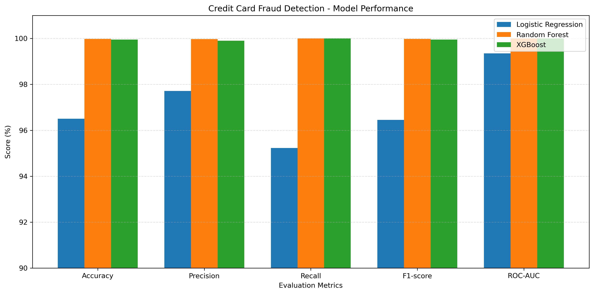

# Credit Card Fraud Detection Using Machine Learning

## Project Overview

This project focuses on developing machine learning models to identify fraudulent credit card transactions.

The objective is to analyse transaction data, identify patterns associated with fraudulent activities and evaluate different classification algorithms.

Three machine learning models were developed and evaluated:

- Logistic Regression
- Random Forest
- XGBoost

## Business Problem

Financial fraud presents a significant challenge to banks and financial institutions.

Identifying fraudulent transactions accurately helps reduce financial losses, protect customers and improve transaction security.

This project explores how machine learning can support automated fraud detection.

## Dataset

*Dataset:* Credit Card Fraud Detection Dataset 2023

*Source:* Kaggle

[Access the dataset](https://doi.org/10.34740/KAGGLE/DSV/6492730)

- Total transactions: 568,630
- Total features: 31
- Target variable: Class
- Class 0: Legitimate transactions
- Class 1: Fraudulent transactions

The dataset contains anonymised transaction features and transaction amounts.

## Technologies and Tools

- Python
- Jupyter Notebook
- Pandas
- NumPy
- Matplotlib
- Seaborn
- Scikit-learn
- XGBoost

## Project Workflow

1. Data loading and inspection
2. Data cleaning and quality assessment
3. Exploratory Data Analysis (EDA)
4. Feature investigation
5. Data preprocessing
6. Model development
7. Model evaluation
8. Five-fold stratified cross-validation
9. Model performance comparison

## Machine Learning Models

Three classification algorithms were evaluated:

1. Logistic Regression
2. Random Forest Classifier
3. XGBoost Classifier

## Model Performance Comparison

| Metric | Logistic Regression | Random Forest | XGBoost |
|---|---:|---:|---:|
| Accuracy | 96.50% | 99.98% | 99.95% |
| Precision | 97.71% | 99.97% | 99.90% |
| Recall | 95.23% | 100.00% | 100.00% |
| F1-score | 96.45% | 99.98% | 99.95% |
| ROC-AUC | 99.35% | 100.00% | 100.00% |

## Visual Results

The chart below compares the performance of the three machine learning models.

# Best Perfoming Model

Random Forest achieved the strongest overall results:

- Accuracy: 99.98%
- Precision: 99.97%
- Recall: 100.00%
- F1-score: 99.98%
- ROC-AUC: 100.00%

## Project Limitations

This project demonstrates the application of data analysis and supervised machine learning techniques to a financial fraud detection problem.

Three classification algorithms were developed and evaluated. Random Forest achieved the strongest overall performance, while XGBoost also delivered highly competitive results.

The project strengthened practical skills in Python programming, data analysis, exploratory data analysis, feature investigation, machine learning, model evaluation, cross-validation, and data visualisation.

## Conclusion

This project demonstrates the application of data analysis and supervised machine learning techniques to a financial fraud detection problem.

Three classification algorithms were developed and evaluated. Random Forest achieved the strongest overall performance, while XGBoost also delivered highly competitive results.

The project strengthened practical skills in Python programming, data analysis, exploratory data analysis, feature investigation, machine learning, model evaluation, cross-validation, and data visualisation.

## Author

*Golden Gabula*

Aspiring Data Scientist | Data Analyst | Machine Learning Practitioner

GitHub: https://github.com/bu-khosi

LinkedIn: https://www.linkedin.com/in/golden-gabula-610a21266

---

Developed independently for practical learning and professional portfolio purposes.
